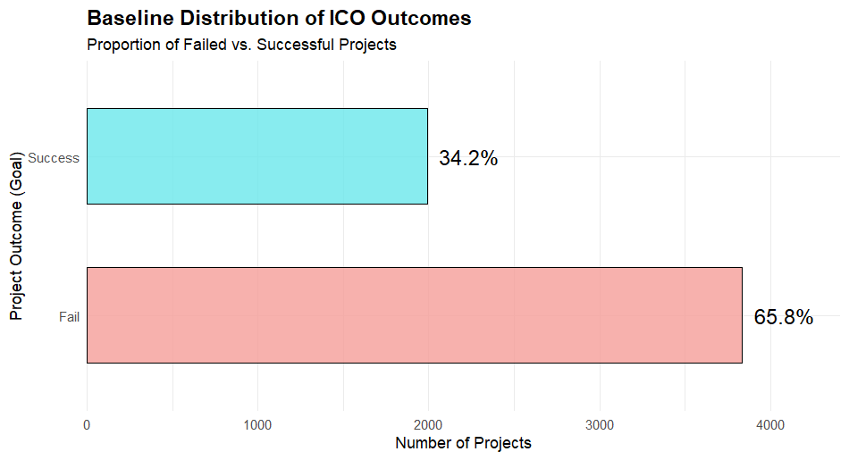
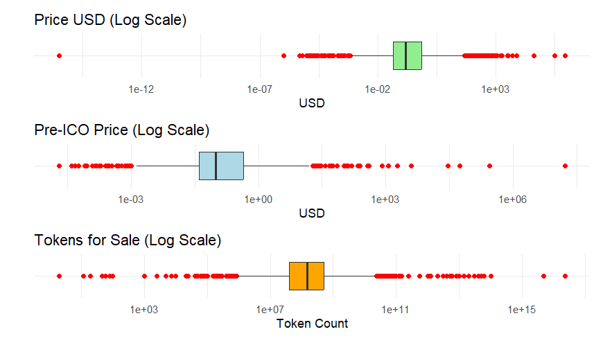
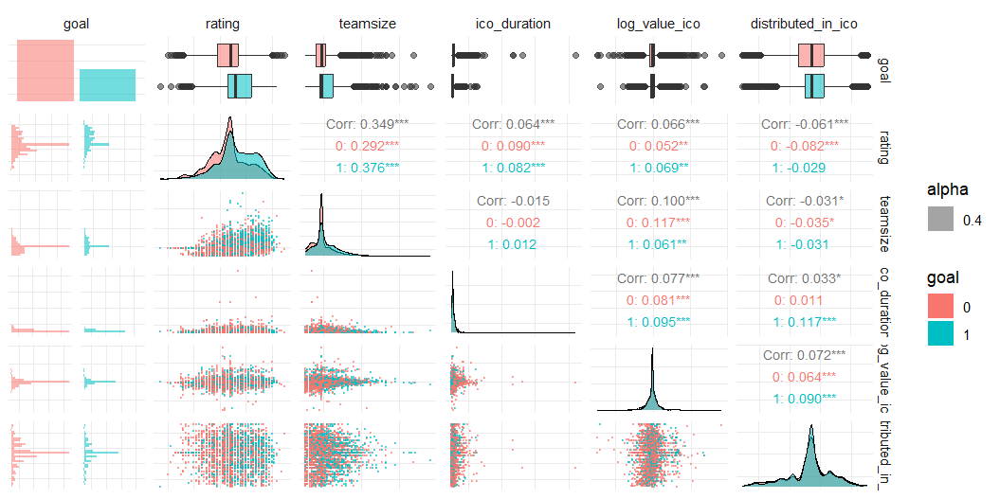
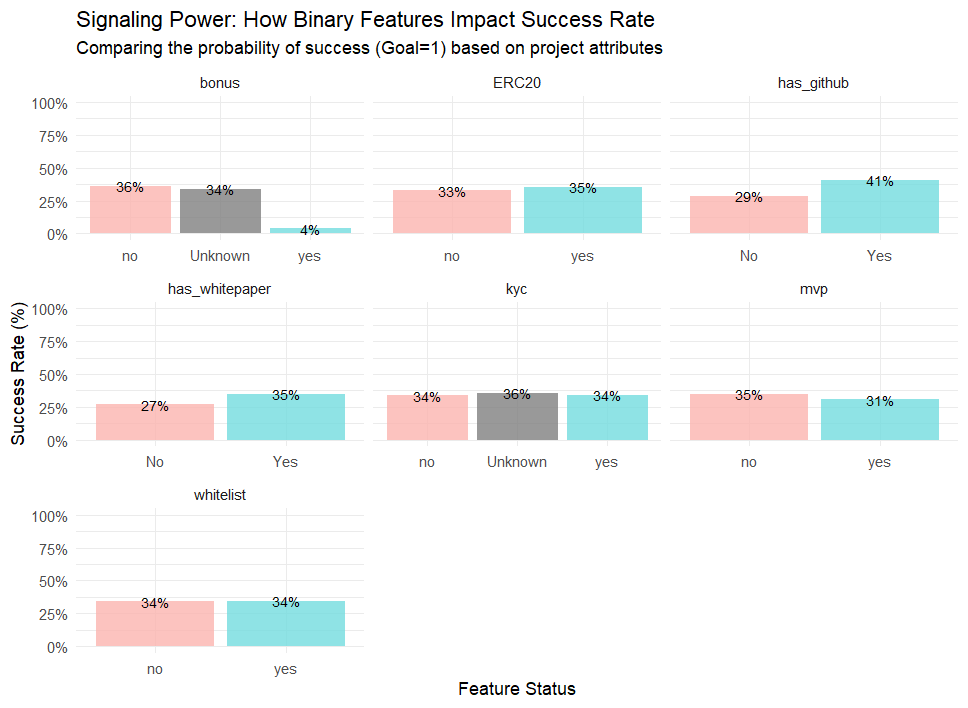
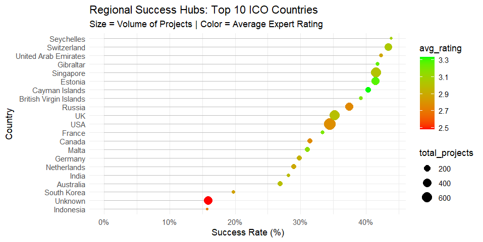
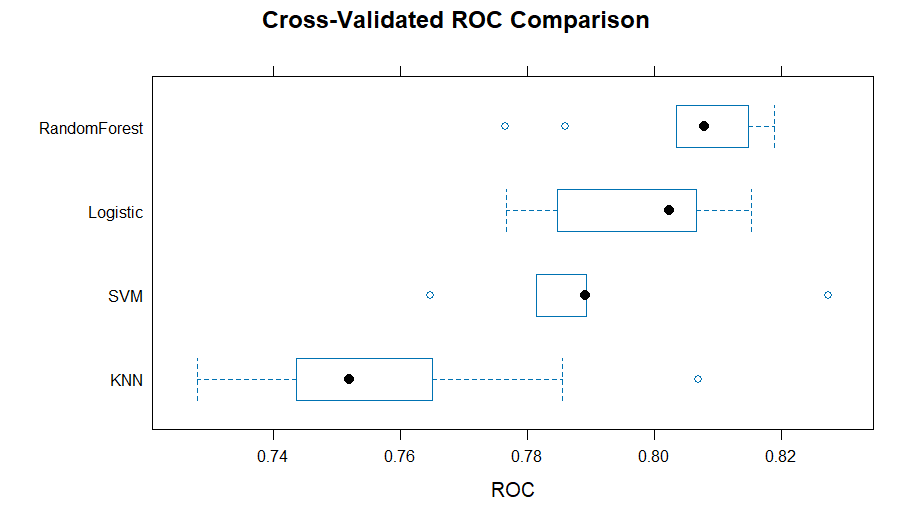
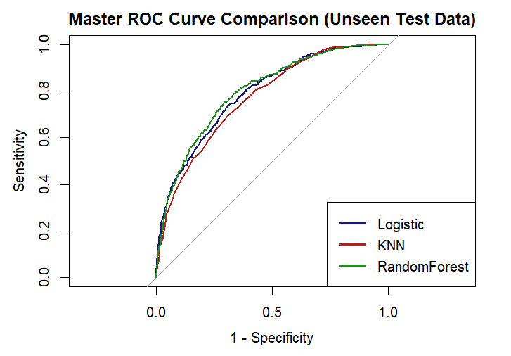
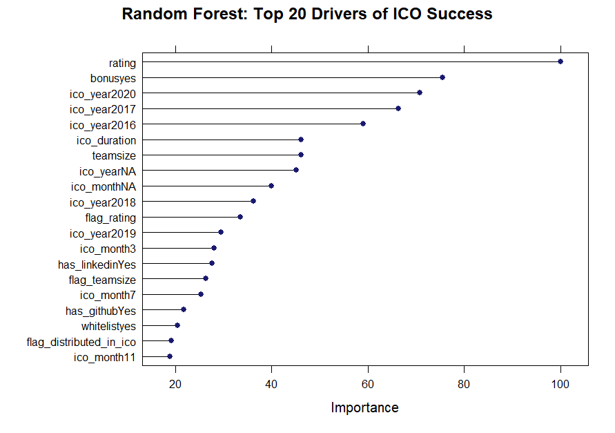

# Predicting ICO fundraising success with classic machine learning

Can the information a crypto project publishes *before* launch predict whether it will reach its fundraising goal? I built and compared four classification models in R to answer that, for investors who face huge information asymmetry and frequent scams.

| | |
|---|---|
| **Context** | MSc Consumer Analytics & Marketing Strategy, University of Leeds. Module: Machine Learning in Practice. Individual coursework, 2026 |
| **Data** | 5,828 Initial Coin Offering (ICO) campaigns, 22 variables, real-world and messy |
| **Task** | Binary classification: did the campaign reach its funding goal? |
| **Models** | Logistic regression, k-Nearest Neighbours, Support Vector Machine (RBF), Random Forest |
| **Tools** | R: tidyverse, caret, pROC, GGally |
| **Result** | Random Forest selected: **AUC 0.798** on unseen data, precision 0.681, F1 0.565 |

---

## The problem

An Initial Coin Offering lets a start-up raise money by selling digital tokens, like a crowdfunding campaign on the blockchain. If the campaign misses its goal, it gets nothing. There is no regulator checking the projects, so investors carry all the risk with whatever the founders choose to disclose: a whitepaper, a team page, a rating from experts, token details.

The goal was a **screening tool**: a model that flags which campaigns are worth an investor's due diligence, using only pre-launch information.

## Workflow

The project follows the CRISP-DM process:

1. **Business understanding:** who decides, what a wrong prediction costs.
2. **Data understanding:** class balance, distributions, outliers, relationships with the target.
3. **Data preparation:** cleaning, feature engineering, missing-data strategy, train/test split.
4. **Modelling:** four algorithms from different families, tuned with cross-validation.
5. **Evaluation:** performance on a hold-out set and the business trade-offs between models.
6. **Deployment:** what drives success and how an investor should use the model.

## 1. Data understanding

**Class balance.** About one in three campaigns succeeded. The imbalance is moderate, so accuracy alone would be misleading: a model that always predicts "fail" is right 66% of the time.



**Extreme outliers.** Token prices and token counts span many orders of magnitude, with single tokens priced above USD 800,000. A log scale shows that most projects still cluster around a predictable centre.



**Weak linear signals.** No numeric variable predicts success on its own. The clearest signals are expert **rating**, which is skewed higher for successful projects, and its correlation with **team size** (about 0.35). Weak, scattered relationships like these are why non-linear models were worth trying.



**Binary features.** Most "credibility" signals (KYC, whitelist, MVP) barely change the success rate. Two stand out: having a **GitHub** page (41% vs 29%) and, in the opposite direction, offering a **bonus** to buyers (4% success vs 36%). A monetary hook looks like a red flag.



**Country.** Rating matters more than location: small hubs like Switzerland and Seychelles beat the USA and UK. Projects that hide their country have the worst success rate of all, around 16%.



## 2. Data preparation

Only about 20% of the rows had every variable filled in, so dropping incomplete rows was not an option.

- **Cleaning:** standardised inconsistent categories (`"Yes"`, `"1.0"`, `"True"`, `"Y"` all meaning yes), rescaled `distributed_in_ico` values stored as percentages or thousands to a 0 to 1 proportion, parsed dates and set impossible durations (end before start) to missing.
- **Feature engineering:**
  - `ico_duration` from start and end dates.
  - `log_value_ico` = log10(price × tokens for sale), the size of the raise on a usable scale.
  - `has_github`, `has_linkedin`, `has_whitepaper`, `has_website` from the link fields.
  - `ico_year` and `ico_month` to capture the market cycle.
- **Missing data, two steps:**
  1. **Shadow flags** (`flag_rating`, `flag_teamsize`, ...) record that a value was missing, so the model can learn whether *hiding* information is itself a signal.
  2. **Imputation:** median for numeric variables (robust to the outliers) and an explicit `"Unknown"` level for categorical ones.
- **High cardinality:** countries lumped into the top 10 plus "Other".
- **Split:** stratified 80/20 train/test split, keeping the 34/66 class ratio in both sets.

## 3. Modelling

Four algorithms from different families, so the comparison covers different ways of learning the same boundary:

| Model | Family | How it decides | Tuning |
|---|---|---|---|
| **Logistic regression** | Linear, probabilistic | Weighs each feature linearly to estimate the probability of success. The interpretable baseline. | Removed redundant, collinear predictors (`kyc`, `ERC20`, `has_whitepaper`, `has_github`) |
| **k-Nearest Neighbours** | Instance-based | Labels a campaign by the outcome of the most similar past campaigns. | Grid search over k from 5 to 85 |
| **Support Vector Machine** | Kernel, margin-based | Finds the widest boundary between classes; the RBF kernel lets it bend. | Grid over cost C and sigma |
| **Random Forest** | Ensemble of decision trees | Averages hundreds of trees, each trained on random rows and features. | Grid over mtry from 2 to 15; best mtry = 6 |

All models were trained with **10-fold cross-validation**, optimising ROC AUC. Numeric inputs were centred and scaled for the logistic regression, k-NN and SVM models.

**Cross-validated results.** Random Forest had the best mean AUC (0.805), followed by logistic regression (0.798). k-NN was clearly the weakest and the most variable.



## 4. Evaluation on unseen data

The 20% hold-out set gives the honest measure of how each model would perform on new campaigns.

| Model | AUC | Precision | F1 |
|---|---|---|---|
| **Random Forest** | **0.798** | 0.681 | 0.565 |
| Logistic regression | 0.789 | 0.636 | 0.571 |
| k-Nearest Neighbours | 0.770 | **0.709** | 0.472 |
| Support Vector Machine | n/a* | 0.612 | 0.490 |

*\*The SVM's probability calibration (Platt scaling) failed to converge on the test data, so only class predictions were available.*



**Reading the trade-offs.**
- **AUC** measures how well a model ranks good projects above bad ones across every threshold. It was the main metric because it handles the class imbalance.
- **Precision** is risk control: of the projects the model recommends, how many actually succeed.
- **F1** balances precision with recall: how many of the real successes the model catches.
- **k-NN** had the best precision (0.709) but the worst F1: it plays it safe by predicting "fail" for most projects, so an investor would miss many good opportunities. It suits only an ultra-conservative investor.
- **Random Forest** had the best AUC and kept precision high while catching far more successes. It was chosen as the model to deploy.
- **The SVM** scored well in training but could not express how confident it was in each prediction. For an investment decision, a model that cannot quantify its own certainty is a liability.

## 5. What drives success



- **Expert rating** is by far the strongest predictor.
- **Offering a bonus** is the second strongest, and it points to failure.
- **Market timing** (`ico_year`) carries a lot of weight: success depended heavily on the crypto cycle in which a campaign launched.
- **Team size, duration and transparency signals** (LinkedIn, GitHub, missing-data flags) add smaller but consistent information.

## Conclusions

1. **A model is a useful complement to due diligence.** With an AUC of about 0.80, a Random Forest can rank pre-launch campaigns well enough to focus an investor's attention.
2. **Start with the expert rating.** It is the single most informative input and deserves the deepest scrutiny.
3. **Treat bonuses and hidden information as red flags.** Monetary hooks and missing basic data are associated with failure.

## Next steps

- **Gradient boosting (XGBoost):** sequential trees that learn from the previous trees' errors, often stronger on tabular data like this.
- **Text analysis (NLP) of the whitepapers,** to turn the documents themselves into features.
- **Richer expert data:** the reasoning behind each rating, not just the score.

## Repository

```
R/coursework_v1.R   Full analysis: cleaning, EDA, feature engineering, models, evaluation
figures/            Figures produced by the script, as used in the report
data/               Not included (see below)
```

**Data.** The dataset was provided by the University of Leeds for the module and is not redistributed here. To run the script, place the course CSV in the working directory. The script is published exactly as submitted.

---

*Tomás Mora · [Portfolio](https://tmorac.github.io/analytics/) · [LinkedIn](https://www.linkedin.com/in/tomas-mora-c)*
